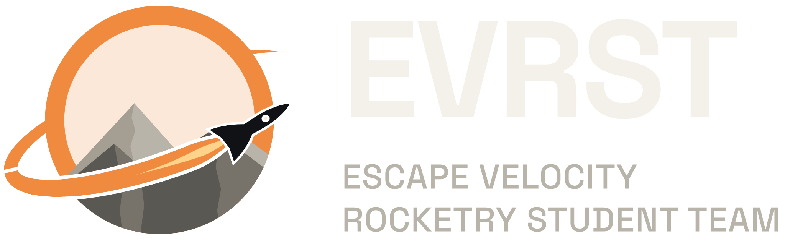

 

## Hey, this is us

Escape Velocity Rocketry Student Team (EVRST) is a student-led rocketry team based at Óbuda University. We design, build, and launch experimental rockets, push the limits of student engineering, and prepare to compete on the international stage.

Visit [evrst.hu](https://evrst.hu/) to learn more!

## Get Involved

Our members can contribute to the codebase here. Our current and archived source codes are available in our repositories.
